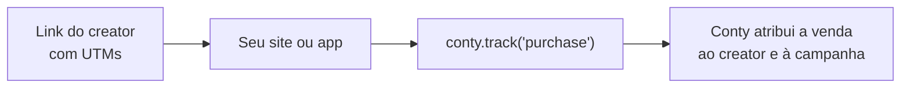

<p align="center">
  <picture>
    
  </picture>
</p>

<p align="center">
  Mande as conversões do seu site, app ou servidor para a Conty e saiba qual creator trouxe cada venda.
</p>

<p align="center">
  <a href="https://github.com/Conty-App/conty-sdk/actions/workflows/ci.yml"></a>
  <a href="LICENSE"></a>
</p>

<p align="center">
  <a href="https://help.appconty.com/api/guias/eventos-de-conversao"><b>Documentação</b></a>
  &nbsp;·&nbsp;
  <a href="https://appconty.com"><b>Painel</b></a>
  &nbsp;·&nbsp;
  <a href="CONTRIBUTING.md"><b>Contribuir</b></a>
</p>

## Como funciona



1. O creator divulga um link com `utm_campaign` e `utm_content` (o código dele, `cr_` seguido de 8 caracteres hexadecimais, ou o id (UUID) do creator).
2. O SDK guarda essa atribuição por 30 dias quando a pessoa chega no seu site ou abre o app, só se o link trouxer os dois: `utm_campaign` e o código do creator em `utm_content`.
3. Cada `conty.track` leva a atribuição junto, e a Conty credita o creator e a campanha.

Vale o **último toque com creator**: um link novo de creator substitui a atribuição guardada, e um link sem `utm_campaign`, só de campanha (sem o código do creator em `utm_content`) ou sem UTM não apaga nada.

## Duas chaves

| Chave | Onde usar | Pacotes |
| --- | --- | --- |
| Pública, `cpk_...` | Site e app. Fica visível no código, então a API ignora `value_cents`, guarda o `external_id` como `pk:<id>` e só aceita as origens permitidas da chave, quando você define alguma. | `@conty/web`, `@conty/react-native` |
| Secreta, `cev_...` | Só no servidor. Conta o valor e usa o seu id do pedido. | `@conty/node` |

As duas são criadas no painel, em Desenvolvedores. **Compra com valor sai do servidor**, com o `@conty/node` e a chave secreta. No site e no app, mande os passos do funil.

## Pacotes

| Pacote | Onde roda | Status |
| --- | --- | --- |
| [`@conty/web`](packages/web) | Navegador, por script tag ou npm | pronto |
| [`@conty/node`](packages/node) | Servidor: Node 20+, Workers, Deno, Bun | pronto |
| [`@conty/react-native`](packages/react-native) | App React Native e Expo, UTM pelo deep link | pronto |

## Começar

### Script tag

Cole no `<head>` de todas as páginas, com a sua chave pública (`cpk_...`):

```html
<script>
  window.conty = window.conty || { q: [], track(...args) { this.q.push(args); } };
</script>
<script async src="https://conty.link/sdk.js" data-key="cpk_..."></script>
```

```js
conty.track("sign_up");
conty.track("begin_checkout", { plan: "anual" });
```

### npm (navegador)

```bash
npm install @conty/web
```

```ts
import { conty } from "@conty/web";

conty.init("cpk_...");
conty.track("begin_checkout", { plan: "anual" });
```

### React Native e Expo

```bash
npm install @conty/react-native @react-native-async-storage/async-storage
```

```ts
import { conty } from "@conty/react-native";

conty.init("cpk_...");
conty.track("sign_up");
```

As UTMs vêm do deep link que abriu o app. Veja o [README do pacote](packages/react-native) para Expo, bare e `captureUrl`.

### Node (webhook da loja)

```bash
npm install @conty/node
```

```ts
import { createConty } from "@conty/node";

const key = process.env.CONTY_EVENT_KEY;
if (!key) throw new Error("CONTY_EVENT_KEY ausente");

const conty = createConty({ key });

const { error } = await conty.track({
  event: "purchase",
  external_id: order.id,
  value_cents: order.totalCents,
  utm_campaign: order.utmCampaign,
  utm_content: order.utmContent,
});
if (error) logger.warn(error.code, error.message);
```

Use a chave secreta (`cev_...`). `value_cents` é o valor em centavos. `external_id` é o seu id do pedido: ele evita contar a mesma venda duas vezes. O `track` nunca lança erro de API nem de rede: ele devolve `{ data, error }`.

## Exemplos

| Pacote | Exemplos |
| --- | --- |
| `@conty/web` | [script tag](packages/web/examples/html) · [Next.js](packages/web/examples/nextjs) |
| `@conty/node` | [webhook com Express](packages/node/examples/express) · [script de reenvio](packages/node/examples/script) |
| `@conty/react-native` | [Expo](packages/react-native/examples/expo) · [bare](packages/react-native/examples/bare) |

Os exemplos ficam fora dos workspaces da raiz: cada um instala o pacote local por `file:../..` e tem as instruções no próprio README. O `npm install` da raiz não baixa Next, Expo nem Express.

## Privacidade

- Sem cookies. O navegador guarda só as UTMs do link, em `localStorage` (`conty_attribution`), por 30 dias. No app, a mesma chave vai para o AsyncStorage ou o armazenamento que você passar.
- O SDK não coleta dado pessoal por conta própria: manda só o que você passa no `track`.
- O IP de quem manda o evento só serve para o limite de requisições e não é gravado com o evento.

## Contribuir

Como preparar o ambiente, as regras de código e o checklist de PR estão em [CONTRIBUTING.md](CONTRIBUTING.md).

```bash
npm install
npm run lint      # biome check .
npm run format    # biome check --write .
npm run typecheck
npm test
npm run build
```

---

<p align="center"><sub>MIT © App Conty LTDA</sub></p>
